# 모듈 3 과제

## 1. 실행 환경과 입력

| 항목 | 내용 |
| --- | --- |
| 코드 | [ROS-Vision-Tracker](https://github.com/chj1319/ROS-Vision-Tracker) `f936d11` + Mask 토픽 발행 추가 (`tracker_node`, `rviz2_launch.py`) |
| 환경 | Ubuntu 24.04.5 · ROS 2 Lyrical · Python 3.12.3 · OpenCV 4.6.0 |
| 입력 | rosbag `p5_success` (2026-10-08, RealSense D435, 640×360) — 실시간 Camera 아님 |
| 관찰 구간 | 18.6 s부터 Raw 7프레임, stamp `1791422051.500585067` ~ `1791422051.760307693` (멈춘 채 시작해 한 개씩 재생) |
| 목표 없음 입력 | `p5_loss_return` 5–8 s |

코드 변경 내용, 실행 명령, 설정 적용 방법은 [README.md](README.md) 참고

---

## 2. 토픽 구성

| 자료 | 토픽 이름 | 메시지 타입 | 발행 노드 | 수신 도구 |
| --- | --- | --- | --- | --- |
| Raw Image | `/camera/color/image_raw` | `sensor_msgs/msg/Image` | `rosbag2_player` (bag 재생) | RViz2 Image 디스플레이 (`raw_Image`) |
| Mask | `/tracking/mask` | `sensor_msgs/msg/Image` | `tracker_node` | RViz2 Image 디스플레이 (`mask_Image`) |
| 검출 결과(수치) | `/tracking/bbox` | `geometry_msgs/msg/PolygonStamped` | `tracker_node` | `ros2 topic echo` |
| 검출 결과(수치) | `/target` | `geometry_msgs/msg/PointStamped` | `tracker_node` | `ros2 topic echo` |
| 검출 상태 | `/perception_status` | `std_msgs/msg/String` | `tracker_node` | `ros2 topic echo` |
| 검출 결과(Overlay) | `/tracking/image` | `sensor_msgs/msg/Image` | `rviz_node` | RViz2 Image 디스플레이 (`Tracking Image`) |

### 2.1 Raw Image

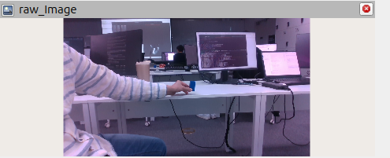

- 해상도 **640 × 360**, `encoding` **`rgb8`**, `frame_id` `camera_color_optical_frame` (`results/exp1_A/echo_raw.txt`)
- `tracker_node`는 `imgmsg_to_cv2(..., desired_encoding='bgr8')`로 받아 cv_bridge가 R·B 순서를 바꿈. 뷰어에서 큐브가 파랗게 보이므로 라벨과 실제 채널 순서도 일치

### 2.2 Mask

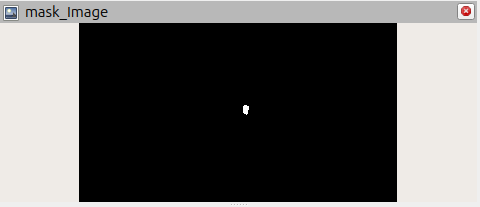

- **값의 의미(코드 기준):** `mono8`, 255(흰색) = 아래 조건을 모두 통과한 전경, 0(검정) = 배경. `detector.py` `color_mask()`에서 생성
  1. Gaussian blur 5×5 (`processing.blur_ksize: 5`)
  2. BGR→HSV, `cv2.inRange(hsv, [104, 200, 8], [120, 255, 255])` (`target.hsv_ranges`)
  3. 색 세기 `max(B,G,R) − min(B,G,R) ≥ 5` (`target.min_chroma`) — 어두운 픽셀의 S 잡음 제거
  4. 열림 1회 → 닫힘 2회, 5×5 타원 커널
- **이 Mask는 후보 필터(면적·모양·뎁스) 전 단계의 출력.** 따라서 HSV 값을 바꾸면 Mask가 바뀌고,
  면적 임계값을 바꾸면 Mask는 그대로이고 검출 결과만 바뀌어야 함
- 원본과 비교 (해상도 640 × 360, `mono8`, `results/exp1_A/echo_mask.txt`):
  - 목표에서 남은 영역: 큐브 한 덩어리만 흰색으로 남음. 위치는 Raw Image의 큐브 위치와 같음
  - 목표 외에 남은 영역: 없음. 청바지, 셔츠 줄무늬, 뒤쪽 책상의 작은 파란 물체는 모두 검정
    이 물체들의 S가 하한 200보다 낮아 `inRange`에서 빠진 것으로 보임
  - 누락된 부분: 큐브를 쥔 손가락이 가린 쪽 가장자리가 살짝 파임. 그 밖에 큐브 면에서 크게 빠진 부분은 없음
- HSV 범위 읽는 위치: `tracker_node`가 시작할 때 `detector.load_config(detector_config)`로 한 번 읽음
  → **실행 중에는 바뀌지 않으므로, 값을 바꾸면 노드를 재시작**하고 시작 로그 `Detector config ...: HSV [...]`로 적용값 확인

### 2.3 검출 결과

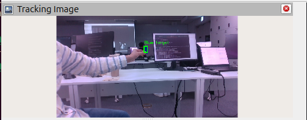

| 토픽·필드 | 의미 | 단위 | 미검출일 때 |
| --- | --- | --- | --- |
| `/tracking/bbox` `polygon.points[0]` | 박스 왼쪽 위 (x, y) | 입력 영상 픽셀 | `points: []` |
| `/tracking/bbox` `polygon.points[1]` | 박스 오른쪽 아래 (x, y), 포함 좌표 | 입력 영상 픽셀 | — |
| `/target` `point.x` | 목표 중심의 가로 오차 (cx − W/2)/(W/2) | 무단위, −1~1 | 0.0 |
| `/target` `point.y` | 목표 중심의 세로 오차 (cy − H/2)/(H/2) | 무단위, −1~1 | 0.0 |
| `/target` `point.z` | 컨투어 면적 / (W×H) — **거리가 아님** | 무단위, 0~1 | 0.0 |
| `/perception_status` `data` | `OK` / `NO_TARGET` / `CAMERA_STALL` | 문자열 | `NO_TARGET` |

- 근거: `detector.py`의 `normalized_error()`, `area_ratio`, `tracker_node.py`의 `process_frame()`
  상태는 `point.z > 0`이면 `OK`, 아니면 `NO_TARGET`. 입력이 `stall_timeout` 0.5 s 이상 끊기면 `CAMERA_STALL`
- 메시지에 검출 수, 후보 개수, 깊이(m)는 없음
- 실제 수신 예(실험 1-A 설정):
  - `/tracking/bbox` stamp `1791422051.500585067`: (333, 165)–(345, 186) → 박스 13 × 22 px, 중심 (339, 175.5)
  - `/target` 같은 stamp: x 0.059, y −0.030, z 0.000786
- Overlay(`/tracking/image`)는 `rviz_node`가 Raw Image와 같은 stamp의 `/tracking/bbox`를 짝지어 초록 박스와 `Blue target` 글자를 그린 것.
  `exp1_A_tracking.png`에서 초록 박스가 큐브 위에 그려져, 표시된 박스와 목표 위치가 일치

### 2.4 흐름도

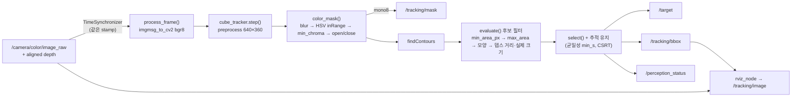

| 단계 | 위치 |
| --- | --- |
| Raw Image 수신 | `tracker_node.py` — 구독, `process_frame()`의 `imgmsg_to_cv2` |
| Mask 생성 | `detector.py` `color_mask()` |
| Mask 발행 | `tracker_node.py` `process_frame()` |
| 후보 필터 | `detector.py` `evaluate()` |
| 검출 결과 발행 | `tracker_node.py` `process_frame()` (`/target`, `/tracking/bbox`) |

---

## 3. 실험 설계

| 공통 통제 조건 | 값 |
| --- | --- |
| 입력 | `p5_success` 18.6 s부터 Raw 7프레임 (`…051.500585067` ~ `…051.760307693`, A·B의 `echo_raw.txt` stamp 7개가 모두 같음) |
| 처리 해상도 | 640×360 (`processing.width/height`) |
| 그 밖의 설정 | `detector.yaml` 원본과 동일. 실험마다 **한 줄만** 다른 사본 사용 |
| 적용 방법 | `-p detector_config:=<사본>`으로 노드 재시작, 시작 로그로 적용값 확인 |
| 비교 프레임 | A·B **둘 다 처리한 프레임**으로 비교. `tracker_node`는 20 Hz 타이머마다 가장 최신 프레임만 처리하므로 처리되는 프레임이 실행마다 다를 수 있음. 실험 1: `…051.500585067`, `…051.587908962` |

### 실험 1 — Mask 생성: HSV S 하한 (`target.hsv_ranges[0].lower[1]`)

| | A (기준) | B (변경) |
| --- | --- | --- |
| HSV lower | [104, **200**, 8] | [104, **100**, 8] |
| HSV upper | [120, 255, 255] | [120, 255, 255] |

- **값의 의미:** OpenCV HSV에서 S(채도)는 0~255. `inRange`는 S ≥ 하한인 픽셀만 255로 둠. 하한을 낮추면 덜 진한 파란색도 감지
- **선택 이유:** 설정 파일의 실측 기록에 따르면 큐브 S는 248~255, 같은 H 범위의 배경(보라 의자·청회색 카펫) S는 중앙값 69~83, 상위 1% 124~163.
  즉 S 하한은 큐브와 배경을 가르는 핵심 경계
- **예상:**
  - Mask: 큐브 영역은 A·B 모두 남음(S 248~255는 둘 다 통과). B에서는 마스킹 영역이 넓어짐
  - 검출: 새로 생긴 배경 덩어리가 큐브와 떨어져 있으면 모양·크기·균일성 검사에서 대부분 탈락해 검출 결과는 A와 비슷할 것으로 예상.
    큐브와 붙으면 덩어리가 커져 `size_mismatch`로 탈락할 수 있음. 이 경우 `color_split`(S ≥ 240)이 큐브만 다시 잘라내면 검출 유지

### 실험 2 — 검출 후보 필터: 최소 면적 (`depth.min_area_px`)

| | A (기준) | B (변경) |
| --- | --- | --- |
| `depth.min_area_px` | **60** px | **300** px |
| HSV | [104, 200, 8]–[120, 255, 255] (A·B 동일) | 동일 |

- **값의 의미:** 컨투어 면적(px², 640×360 기준)이 이보다 작으면 `too_small`로 탈락.
  뎁스가 있으면 `selection.min_area`가 아니라 이 값이 쓰임
- **선택 이유:** 큐브 크기(30×30×60 mm)와 거리에 따라 면적이 크게 변함. 설정 파일 기록상 1 m에서 큐브 최소 면적은 211 px.
  300은 이보다 큰 값이라, 먼 거리의 큐브가 잡음과 함께 걸러지는지 볼 수 있음
- **예상:**
  - Mask: A·B가 같을 것으로 예상
  - 검출: 관찰 구간의 큐브 컨투어 면적이 300 px보다 크면 A·B 모두 검출, 작으면 B에서만 미검출.
    60~300 px의 작은 잡음 덩어리가 있었다면 B에서 사라짐

---

## 4. 실험 결과와 분석

### 4.1 실험 1 결과

| 묶음 | Raw Image | Mask | 검출 결과 (Tracking Image) |
| --- | --- | --- | --- |
| 1-A (S 200) |  |  |  |
| 1-B (S 100) | 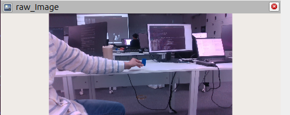 | 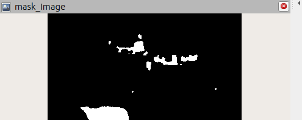 | 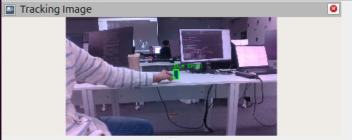 |

| 비교 항목 | A (S 200) | B (S 100) |
| --- | --- | --- |
| 적용값 (`applied.txt`) | `lower: [104, 200, 8]` | `lower: [104, 100, 8]` |
| 처리된 프레임 (Raw 7장 중) | 5장, 모두 검출 | 3장, 모두 검출 |
| 목표 검출 여부 | 검출 (박스 1개, 큐브) | 검출 (박스 1개, 큐브) |
| 불필요한 검출 수 (Overlay를 사람이 센 수) | 0 | 0 |
| bbox @ `…051.500585067` | (333, 165)–(345, 186), 13 × 22 px | (332, 163)–(347, 191), 16 × 29 px |
| bbox @ `…051.587908962` | (333, 165)–(344, 185), 12 × 21 px | (331, 163)–(346, 191), 16 × 29 px |
| `/target` x, y, z @ `…051.500585067` | 0.059, −0.030, 0.000786 | 0.061, −0.025, 0.001343 |
| 큐브 컨투어 면적 (z × 640 × 360) | 181 px / 175 px | 310 px / 312 px |
| `/perception_status` | `OK` | `OK` |
| Mask 변화 | 기준 — 큐브 한 덩어리만 흰색 | 큐브 덩어리 + **청바지(왼쪽 아래 큰 덩어리)**, **뒤쪽 책상 위 물체들(위쪽 가운데 여러 덩어리)**, 작은 점 몇 개 |

**분석**
- 관찰:
  - Mask: S 하한을 100으로 낮추자, A에서 검정이던 파란 계열 배경(청바지, 뒤쪽 책상의 물체)이 흰색으로 새로 나타남.
    큐브 덩어리도 남아 있고, 면적이 약 181 → 310 px로 커짐
  - 검출: B에서도 결과는 큐브 하나이고 오검출은 없음
- 코드 조건:
  - Mask 변화는 S 하한만 200 → 100으로 바뀐 결과.
    S 100~199 픽셀이 새로 통과함. 청바지와 뒤쪽 물체는 H가 104~120 범위이고 S가 100~199인 영역으로 보임
  - 큐브 면적 증가는 큐브 가장자리, 그늘진 면, 손가락과 닿은 경계처럼 S가 200보다 낮은 픽셀이 포함됐기 때문으로 보임
  - 새 배경 덩어리가 검출되지 않은 것은 Mask 다음 단계인 후보 필터(`evaluate()`) 때문
- 예상과 비교: Mask에 배경이 추가되고 큐브와 검출은 유지된다는 예상과 같음

### 4.2 실험 2 결과

| 묶음 | Raw Image | Mask | 검출 결과 (Tracking Image) |
| --- | --- | --- | --- |
| 2-A (60 px) | 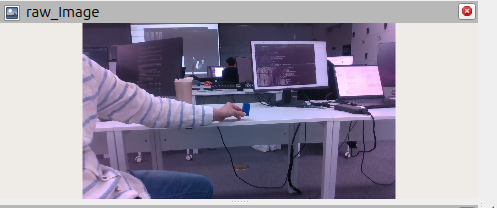 | 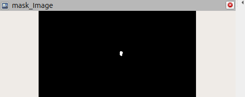 | 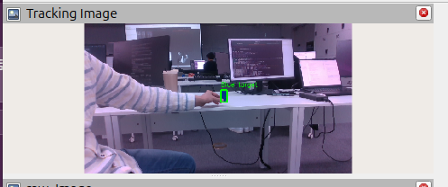 |
| 2-B (300 px) | 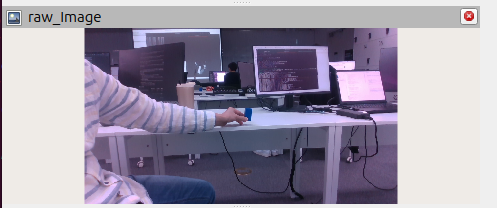 | 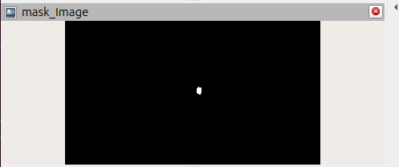 | 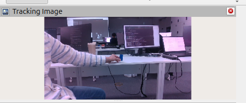 |

| 비교 항목 | A (60 px) | B (300 px) |
| --- | --- | --- |
| 적용값 | `exp2_A_minpx60.yaml` (원본) | `exp2_B_minpx300.yaml` (`min_area_px` 한 줄만 다름, `config/` diff) |
| 처리된 프레임 | 4장 (`…500585067`, `…540335599`, `…626656261`, `…719776667`) | 5장 (`…500585067`, `…540335599`, `…587908962`, `…626656261`, `…668944052`) |
| 공통 비교 프레임 | `…500585067`, `…540335599`, `…626656261` | 같음 |
| Mask가 같은가 | — | 같음. HSV 설정이 같고 큐브 한 덩어리만 흰색(캡처를 사람이 비교) |
| 목표 컨투어 면적 (z × 640 × 360) | 181 / 180 / 175 px | 측정 불가 — 검출되지 않아 z = 0 |
| 목표 검출 여부 | 4장 모두 검출 | **5장 모두 미검출** |
| 불필요한 검출 수 | 0 | 0 |
| bbox @ `…500585067` | (333, 165)–(345, 186) | `points: []` |
| `/target` @ `…500585067` | 0.059, −0.030, 0.000786 | 0.0, 0.0, 0.0 |
| `/perception_status` | `OK` | `NO_TARGET` |

> 컨투어 면적 근거: A의 `/target` z × 640 × 360. B에서는 같은 컨투어가 필터에서 탈락해 z가 0이라 직접 잴 수 없음

**분석**
- 관찰:
  - Mask: A와 B가 같음
  - 검출: A는 같은 입력의 모든 처리 프레임에서 큐브를 검출. B는 모든 처리 프레임에서 상태가 `NO_TARGET`
- 코드 조건:
  - 큐브 컨투어 약 171~181 px은 A의 하한 60보다 커서 통과하고, B의 하한 300보다 작아서 첫 검사에서 탈락.
    통과한 후보가 없으므로 `select()`가 `None`을 돌려주고, `tracker_node`는 `(0, 0, 0)`, 빈 bbox, `NO_TARGET`을 발행
  - 면적 검사는 `findContours` 이후, 즉 Mask 생성 뒤의 단계라서 Mask에는 영향이 없음. **Mask가 같은데 검출만 사라진 것은 Mask 생성과 후보 필터가 서로 다른 단계라는 근거**
- 예상과 비교: 1-A에서 측정한 면적(171~181 px)이 300보다 작아 B에서 미검출될 것이라는 예상과 같음

### 4.3 목표 없음 확인

입력 `p5_loss_return` 5–8 s (bag 시작 `1791422642.485` 기준), 설정 = 최종 선택값(원본 `exp1_A_s200.yaml`, `results/no_target/applied.txt`)
캡처는 `--start-paused --start-offset 5`로 한 프레임씩 재생하며 찍음. echo와 발행 주기는 `-l --start-offset 5 --playback-duration 3` 반복 재생 중에 받음

| 항목 | 수신 결과 |
| --- | --- |
| Raw Image | 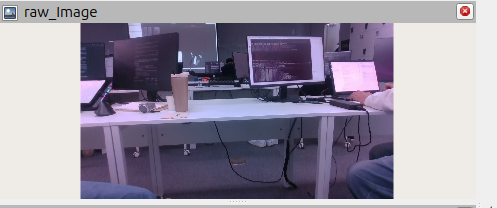 |
| Mask | 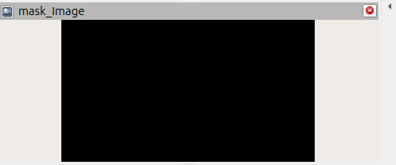 |
| 검출 결과 (Tracking Image) | 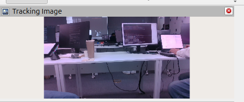 |
| `/tracking/bbox` | 22개 모두 `points: []` (예: stamp `1791422648.753986923`, bag 기준 약 6.3 s) |
| `/target` | 20개 모두 `x: 0.0, y: 0.0, z: 0.0` |
| `/perception_status` | `NO_TARGET` (`echo_status_loop.txt`, 5개 모두) |
| 노드 동작 | `ros2 topic hz /tracking/bbox` 평균 **16.8 Hz** (`hz.txt`). Mask도 `mono8` 640×360으로 계속 수신 |

- Mask는 완전히 검정. S 200 기준으로 이 장면에는 목표색 픽셀이 없어 후보 자체가 생기지 않음
- 미검출은 메시지가 끊기는 것이 아니라 **빈 bbox, 0 좌표, `NO_TARGET`을 계속 발행하는 것**으로 표현.
  입력이 0.5 s 이상 끊겼을 때의 `CAMERA_STALL`과 구분됨. 이 구간에서는 입력과 처리 노드가 모두 계속 동작

---

## 5. 선택값과 결론

| 실험 | 변경 변수 | A값 | B값 | 예상 변화 | 실제 Mask·검출 변화 | 선택값과 이유 |
| --- | --- | --- | --- | --- | --- | --- |
| 1 | `hsv_ranges[0].lower[1]` (S 하한) | 200 | 100 | B에서 파란 계열 배경이 Mask에 추가, 큐브는 유지 | B: 청바지, 뒤쪽 물체가 Mask에 추가. 큐브 면적 181 → 310 px, bbox 13×22 → 16×29. 검출은 둘 다 큐브 1개, 오검출 0 | **A (200)**. 이 입력에서 큐브는 S 200으로도 빠짐없이 검출되고, B는 이득 없이 Mask에 배경 덩어리만 늘림. 배경이 큐브와 붙거나 크기 검사를 통과하는 장면에서 오검출·크기 불일치 위험이 커지고, bbox도 큐브보다 넓어짐 |
| 2 | `depth.min_area_px` | 60 px | 300 px | Mask 동일, 300 px 미만 후보 탈락 | Mask 동일. 큐브(약 171~181 px)가 B에서 `too_small`로 탈락 → 5프레임 모두 `NO_TARGET`, 빈 bbox. 오검출은 A·B 모두 0 | **A (60 px)**. 이 입력(약 1 m)에서 B는 목표를 놓치기만 하고, 걸러 낼 잡음 후보도 없었음. 1 m 거리의 큐브(설정 기록상 최소 211 px)를 지키려면 하한은 그보다 충분히 낮아야 함 |

- **오검출과 미검출:**
  - 실험 1(S 하한 ↓): **오검출 쪽 위험**. Mask에 배경(청바지·뒤쪽 물체)이 들어왔지만, 이번 입력에서는 후보 필터가 걸러 실제 오검출은 0. 대신 큐브 덩어리와 bbox가 커짐
  - 실험 2(면적 하한 ↑): **미검출 쪽 위험**. 실제로 1 m 거리의 큐브를 모든 프레임에서 놓침
  - 두 실험 모두 기준값(A)이 이번 입력에서 목표 누락 0, 불필요한 검출 0. 따라서 최종 선택은 **원본 설정**(S 하한 200, `min_area_px` 60)
